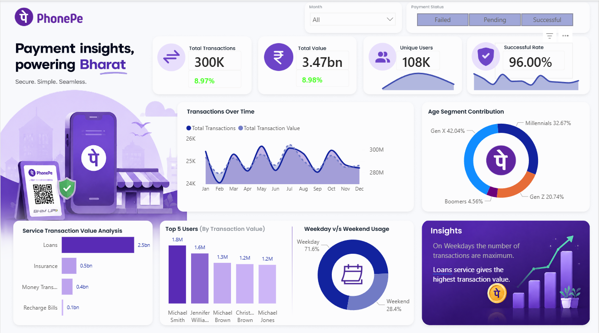

# PhonePe Transaction Insights Dashboard

An interactive Power BI dashboard analysing PhonePe payment transactions.

## Tools Used
Power BI, DAX, Power Query

## Features
- KPI cards with sparkline trends (Total Transactions, Total Value, Unique Users, Successful Rate)
- Month and Payment Status slicers
- Transactions over time, age segment contribution, weekday vs weekend usage
- Service-wise transaction value and Top 5 users by transaction value

## Key Insights
- 300K transactions worth 3.47bn, with a 96% success rate
- Loans is the highest-value service (2.5bn)
- Weekdays account for 71.6% of transactions
- Gen X (42.04%) and Millennials (32.67%) contribute the most

## Files
- `PhonePe_Analysis.pbix`: Power BI report (open with Power BI Desktop)
- `Images/`: dashboard screenshot
